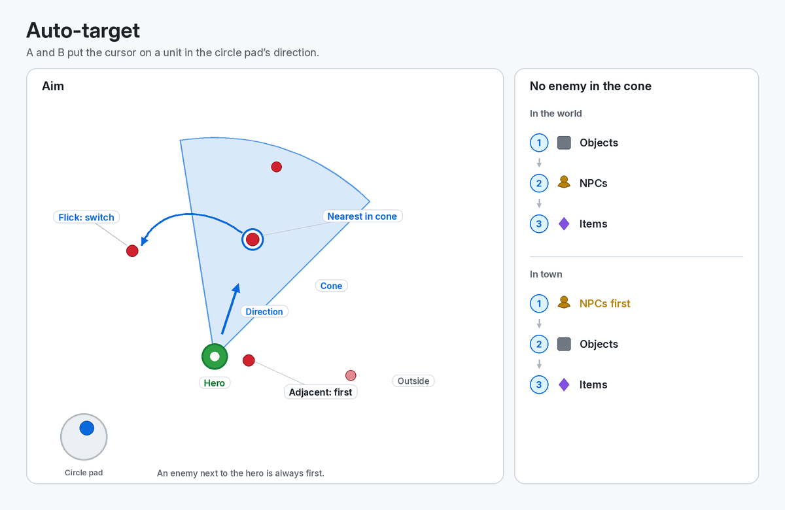

# Fork: auto-target (A and B)

This branch of the fork adds an auto-target to the two attack buttons, and
makes the circle pad's walk in the game world keep off units. On a
console there is no mouse to point at a monster, so in the game world **A** and
**B** first put the cursor on the unit the circle pad points at, and only then
press the left or right mouse button. A stick walk never talks, opens, picks
up, attacks or takes a level warp; let go, and the hero stops where he stands.



The full rules and every setting are in [controls.md](controls.md#auto-target-a-and-b);
this page is the short version and a map of the code.

## How to use it

1. Tilt the circle pad toward an enemy and press **A** (left button: attack,
   walk, pick up) or **B** (right button: the right-hand skill).
2. The cursor jumps onto the nearest enemy in that direction (within a cone
   around the pad's direction, or along your last walking direction when the
   pad is centred). The button goes down once the game itself shows that enemy
   under the cursor (its health bar appears), usually one frame later.
3. Keep the button held: the cursor stays on the target, even if it moves out
   of the cone, and the pad only aims (the hero does not walk off).
4. To switch targets, **flick** the circle pad (a quick push out of the centre;
   a slow tilt is not a flick):
   - toward the target: the next enemy further along that line, then back to
     the nearest;
   - lightly in another direction: the enemy nearest the target that way (a
     sidestep);
   - strongly in another direction: the hero turns to the nearest enemy in that
     direction.
5. With no enemy in the cone or the circle, plain **A** uses objects (shrines, chests,
   waypoints and portals, doors, levers and level warps such as cave
   entrances, stairs and passages to the next area, barrels), then NPCs, then
   the nearest item on the ground. In town, A and B go to the NPCs first.
6. Alt is for highlighting items. With the items shown (Alt: Y held, or Items
   latched on KEYS), A on an item clicks its name. Alt stays held down, and
   while it is held the original game does not report monsters under the
   cursor (no monster name or life bar, a click only walks or picks up), so
   the auto-target cannot attack then. Turn Alt off to fight.
7. Hold **ZR + D-pad** to pick up the items around you one after another:
   **up** unique, set items and runes; **right** gold; **down** everything.
8. When the right-hand skill works on corpses (Raise Skeleton, Corpse
   Explosion, Revive, Find Item...), B aims at corpses by itself. The
   cursor goes just below the corpse's feet, where the game shows a corpse
   under the cursor; once the skill has been cast on it, that corpse is
   skipped for 10 minutes and B goes on to the next one.
9. Tilt the circle pad with no panel open to walk. The cursor orbits the
   hero in the stick's direction and the left button is held; the point
   keeps off NPCs, monsters, objects, items and level warps (cave
   entrances, stairs, passages: the walk never takes the hero to another
   level; standing by one, he can walk away from it but not onto it). Let
   go, and the hero stops where he stands (a one-frame click just ahead of
   him, so he stops facing the way he walked). Turn "Walk stop" off in
   AIM > SETTINGS, or set `aim_walk_stop=0`, to leave that click out. A
   later branch (menu navigation) calls this same walk with one side panel
   open, on the free half of the screen.

Which unit a press goes to, in order:

- **Hover first:** with the circle pad centred, if the game already shows a
  unit under the cursor (an enemy, an NPC, an object, an item or an item's
  name) that the button aims at, A or B clicks exactly that one; the cursor
  is not moved and no other target replaces it while the button is held.
- **Zone I, the cone:** the enemy in the circle pad's direction (or the last
  walking direction) comes first.
- **Zone II, the circle:** with no enemy in the cone, the nearest enemy
  within a melee hit's reach of the hero (`aim_near`, 4 subtiles), all
  round him.
- A monster always comes before an item (or an object): plain A takes items
  only with no enemy in the cone or the circle.

The mercenary, summons and other players are
never targets. **L** (stand still), **R + A/B** and **ZR + A/B** never aim.

## Button mapping (what this branch changes)

| Button | Original port | With the auto-target |
| --- | --- | --- |
| A | Left mouse button at the cursor | Aims at the enemy (or object, NPC, item) in the circle pad's direction, then left button |
| B | Right mouse button at the cursor | Aims at the enemy (or NPC, or a corpse for a corpse skill), then right button |
| Circle pad (in the game world) | Walk: the cursor orbits the character, the left button is held | The same walk, but the point keeps off units and warps; let go, the hero stops where he is ("Walk stop") |
| Circle pad flick (A or B held) | - | Switches to another enemy |
| ZR + D-pad up (held) | Free | Picks up unique and set items, then runes |
| ZR + D-pad right (held) | Free | Picks up gold |
| ZR + D-pad down (held) | Free | Picks up everything |
| ZR + D-pad left | Free | Still free |

## Settings

The settings are lines in `sdmc:/3ds/3ds-d2/settings.txt`, written there at the
first start with their defaults (`aim=1`, `aim_a_mode=enemies`,
`aim_a_cone=45`, `aim_a_range=20`, ...; the full table is in
[controls.md](controls.md#auto-target-a-and-b)). `aim=0` turns the auto-target
off and A and B click where the cursor is, exactly as in the original port.
`aim_walk_stop=1` (default) is the stop click when the pad is let go after a
walk; `0` leaves it out.

Most settings can also be changed while playing on the bottom screen's new
**AIM** tab: its **SETTINGS** page has a row per setting with **-** and **+**
buttons (applied at once and saved), and its **FAQ** page explains the
auto-target in plain words (drag to scroll).

Saving `settings.txt` now keeps the lines the port does not own (comments, and
keys the port only reads, such as `bgquantum=` or `callret=`), and the file is
written a second after the last change instead of on every tap. The
auto-target's keys needed this: before, a tap on the bottom screen rewrote the
file from scratch.

## How it works

The auto-target only produces mouse input; it never calls game code and never
writes the game's memory.

| File | What it does |
| --- | --- |
| `src/game/auto_target.h`, `.cpp` | The rules: what a unit counts as, which one a press or a flick picks, and the state machine that moves the cursor, waits for the game's hover to confirm it and then presses the button |
| `src/game/aim_settings.h` | The `aim*` keys in `settings.txt`, their ranges, and the AIM tab's rows |
| `src/game/aim_faq.h` | The text of the AIM tab's FAQ page |
| `src/game/d2_units.cpp` (`GameAimWorld`) | Reads the hero, the camera, the hover and the nearby units from Diablo II 1.14d's memory (read only), and a warp's click rectangle from LvlWarp.txt |
| `src/game/controls.cpp` | Runs the auto-target on every poll for plain A and B, the ZR + D-pad loot commands, and the stick walk (keep off units and warps, the stop click) |
| `src/game/second_screen.cpp` | The AIM tab (SETTINGS and FAQ pages) |
| `src/game/settings_file.h` | Rewrites `settings.txt` keeping the lines the port doesn't own, and the delayed save |
| `src/app/ctr_game.cpp` | Loads and saves the `aim*` keys, and logs what the auto-target runs with |

`game.log` gets `aim:` lines saying what was chosen and why a target was let go,
and every 30 s of use an `aim: stats:` summary.

## Tests

```
scripts/docker.sh test aim        # the rules, and the walk's keep-off and stop, against made-up units (tests/aim)
scripts/docker.sh test settings   # settings.txt rewritten keeping foreign lines (tests/settings)
scripts/docker.sh test pad        # the pad's existing test, now linking the auto-target too
```

On the Linux lane (`scripts/docker.sh test m4 <game-dir>`), `M4_AIM=0` turns
the auto-target off and `M4_AIM_SETTINGS="aim_b_mode=corpses,aim_near=3"`
changes its settings for a run.
