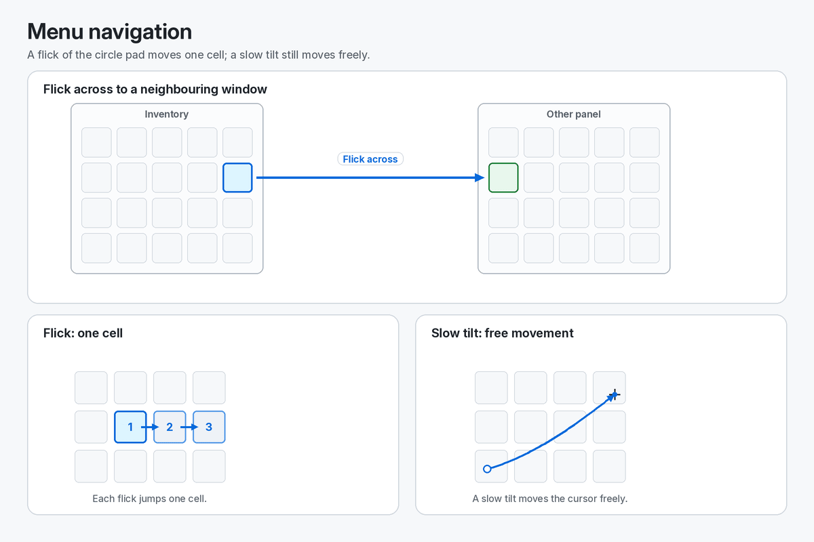

# Fork: menu navigation (flicks in menus and panels)

This branch builds on the [auto-target](fork-auto-target.md) branch. It lets you
move through the game's menus with quick flicks of the circle pad, one cell or
option at a time, the way console games usually work, instead of dragging a
free cursor across them. A slow tilt still moves the cursor freely, as in the
original port.



The full rules are in [controls.md](controls.md#menu-navigation); this page is
the short version and a map of the code.

This first part covers the screens before the game, and the shared flick core
the later parts use.

## How to use it

**Flick** the circle pad (a quick push out of the centre and back; the same
flick the auto-target uses, set by `aim_flick_ms` and `aim_flick_light`) up,
down, left or right:

- **Before the game** (main menu, character select, class screen, difficulty,
  multiplayer screens): the cursor jumps to the next enabled button, text
  field, list, character slot or hero. On the character screen with more than
  eight heroes, a flick right from the right column reaches the scroll bar's
  up and down buttons, and A scrolls one row a press.

The same core also steps one cell at a time in a grid of cells, goes into the
window next to it at the same relative place, comes round a window's edge, and
(with an item on the cursor) puts the cursor on the free half of the screen.
Those rules are used once in-game panels are wired in a later commit on this
branch.

## Button mapping (what this commit changes)

| Button | Before | With menu navigation |
| --- | --- | --- |
| Circle pad flick, before the game | Moves the free cursor a little | Moves the cursor one cell or option |
| Circle pad slow tilt | Moves the free cursor | Unchanged |
| B, before the game (character select, class screen, difficulty, multiplayer screens) | Right mouse button | **Escape**: back to the screen before; on the main menu B does nothing |

The flick itself uses the auto-target's `aim_flick_ms` and `aim_flick_light`.

## How it works

Menu navigation, like the auto-target, only produces mouse and keyboard input.
It reads the game's memory to know where things are and never writes it.

| File | What it does |
| --- | --- |
| `src/game/menu_nav.h`, `.cpp` | The rules, as pure geometry: which cell a flick goes to, between windows, round the edges, the scroll column; tested with made-up windows |
| `src/game/d2_menus.h`, `.cpp` | Reads D2Win's control list before the game |
| `src/game/controls.cpp` | Runs it: flicks to cells on the screens before the game, B as Escape there |

`game.log` gets `menu:` lines saying where each flick went.

When a text field (a hero name, a game name) loses the focus, the on-screen
keyboard closes by itself. While it is open, the sticks and A still reach the
game (`keyboard_pass_through`).

## Tests

```
scripts/docker.sh test menu       # menu navigation against made-up windows (tests/menu)
scripts/docker.sh test aim        # the auto-target, the in-world walk, and the flick this branch shares
scripts/docker.sh test settings   # settings.txt
```
